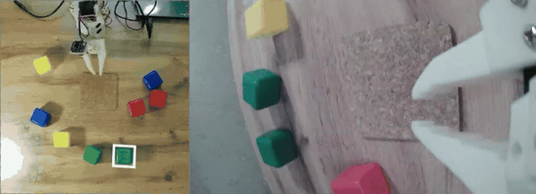
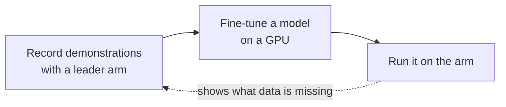
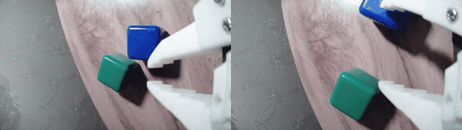
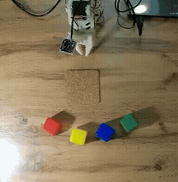
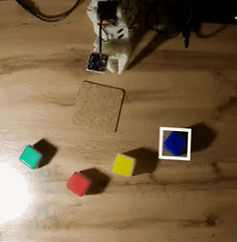

# lerobot_plan_cubes

Tell a desktop [SO-101](https://github.com/TheRobotStudio/SO-ARM100) robot arm which colour of cube to pick, and it places that cube on a cork platform. The next goal is a three-cube pyramid. The models learn from demonstrations recorded with a second, leader arm. Everything below was filmed on the real arm, not in simulation.

<p align="center">
  
</p>
<p align="center"><sub>The pi0.5 model, command "green", no human help. Left: top camera. Right: wrist camera. The white box marks the commanded cube. Sped up 2×. <a href="runs/policy-run-20261105-211635-green.mp4">Full video</a></sub></p>

<!-- VIDEO SLOT: overview -->
<p align="center"></p>
<p align="center"><sub>Video to come: the whole setup from the side.</sub></p>
<!-- /VIDEO SLOT -->

## What works

### Picking a cube by colour

<p align="center">
  
</p>
<p align="center"><sub>The same SmolVLA model, with only the colour in the command changed: red, blue, green, yellow. Top camera above, wrist camera below. Sped up 2×.</sub></p>

In a series of 12 attempts on November 3, 2026, SmolVLA placed 8 cubes, 2 of 3 for each colour, and never took a cube of the wrong colour. [See the results](runs/series-20261103-191936/results.csv). On November 5 the pi0.5 model placed cubes with no human help: blue once, on the very edge of the platform, and green twice. It has not had a counted series yet.

### Building a pyramid from a recording

<p align="center">
  
</p>
<p align="center"><sub>This is not the model yet. <code>recording/replay.py</code> plays back three recorded demonstrations at half speed with no camera feedback, from cubes set out by hand as in the recording. Sped up 14×.</sub></p>

<!-- VIDEO SLOT: pyramid -->
<p align="center"></p>
<p align="center"><sub>Video to come: a whole pyramid.</sub></p>
<!-- /VIDEO SLOT -->

## How it works



### 1. Record

<p align="center">
  
</p>
<p align="center"><sub>A person moves the black leader arm, and the white follower copies it. Sped up 3×.</sub></p>

Two cameras and the joint positions are saved 20 times a second, along with the task text, such as "Pick up the red cube and place it on the platform." There are 159 episodes so far: 108 with one cube to place and 51 for pyramids, three episodes per pyramid.

### 2. Train

[SmolVLA](https://huggingface.co/lerobot/smolvla_base) and [pi0.5](https://huggingface.co/lerobot/pi05_base) are fine-tuned with the [lerobot_cubes](https://github.com/Kotstantinovskiy/lerobot_cubes) fork of LeRobot. On one NVIDIA H100 or H200 this takes about 2 hours for SmolVLA and 14 hours for pi0.5. Three things differ from the standard recipe:

- **Target box.** A colour detector finds the commanded cube and draws a white box around it on the top camera, so the model only has to take what is in the box.
- **Cropped top camera.** Only the table stays in view, so the model cannot learn to wait for the operator, who moves first.
- **Lighting changes.** There is no hue shift, because colour defines the task, but brightness varies more, because all recordings were made in the evening under one lamp.

### 3. Run

`inference/run_policy.py` drives the arm. The model outputs 50 actions at a time, which is 2.5 seconds of motion. `--replan` computes the next batch in the background so the arm never pauses, and `--rtc` (Real-Time Chunking) makes each batch start where the last one ended, which cut the largest jump between batches from 68 to 7.4 joint units.

<p align="center">
  
</p>
<p align="center"><sub>Wrist camera at real speed, similar layouts: without RTC on the left, with RTC on the right.</sub></p>

Every command stays inside the joint range seen in the demonstrations and the `--max-step` limit, and the arm folds back to rest when a run ends, on Ctrl+C or on an error. pi0.5 is too large for the Mac, so `inference/policy_server.py` runs it on a GPU machine and the laptop connects through an SSH tunnel.

### 4. Plan a pyramid

`inference/run_pyramid.py` looks at the top camera and picks the next step: which cube goes where. It does not move the arm yet. The planner is either a plain loop or a language model given a free-text goal, such as "banana colour on top, cool colours below". The language model has not had a real request yet.

To drive the arm by hand from a browser or an iPhone, see [teleoperator](https://github.com/Kotstantinovskiy/teleoperator).

## Progress

| Oct 17, 2026 | Oct 26 | Oct 27 |
| --- | --- | --- |
|  |  |  |
| Base model, no fine-tuning: never reaches the cubes | 20 episodes, command "blue": goes to other cubes | 40 episodes and the box: approaches the right cube but does not take it |

<sub>Top camera, sped up 2.5×. More episodes, the crop and RTC then led to the results at the top of this page.</sub>

## What does not work yet

| Cube turned to the jaws | Wrong cube |
| --- | --- |
|  |  |
| pi0.5 reaches the right cube and hovers over it. Sped up 2×. [Video](runs/policy-run-20261104-185409-green.mp4) | pi0.5 passes over the boxed blue cube and takes the green one. Sped up 2×. [Video](runs/policy-run-20261105-175859-blue.mp4) |

- **No pyramid from the model yet.** It has never placed a cube on top, and pi0.5 fine-tuned on pyramids has not run on the arm.
- **Turned cubes.** At about 40–45° the arm hovers over the cube, while at 25° it still picked it up. This comes from several runs and has not been tested on purpose.
- **The box does not follow the cube.** It is drawn once, before the arm moves, so the model looks for a nudged cube in its old place.
- **Latest code untested on hardware.** The refactor of November 6 passed the tests and matched the old code on simulated devices, but all the runs on this page came before it.

## Setup

You need two SO-101 arms, a top camera and a wrist camera, a Mac next to the arm, and a Linux machine with an NVIDIA GPU for training and for serving pi0.5.

```bash
git lfs install
git clone --recurse-submodules git@github.com:Kotstantinovskiy/lerobot_cubes.git
git clone git@github.com:Kotstantinovskiy/lerobot_plan_cubes.git

cd lerobot_cubes
python3.12 -m venv .venv
.venv/bin/python -m pip install -e '.[smolvla,feetech]' pandas pyarrow
# On macOS only, for the cameras:
.venv/bin/python -m pip install 'opencv-python-headless==4.12.0.88' pyobjc-framework-AVFoundation

cd ../lerobot_plan_cubes
source ../lerobot_cubes/.venv/bin/activate
```

Ports, cameras and calibrations are in `config.json`. On a GPU machine, `bash training/setup_linux.sh` prepares the environment.

## Commands

Run these from the repository root with the environment active.

```bash
# Record demonstrations, taking colours in turn
python recording/record.py --color red,blue,green,yellow --episodes 8 --resume

# Replay an episode, then fold the arm back to rest
python recording/replay.py --episode 157 --speed 0.5
python recording/rest.py

# Train on a GPU machine
bash training/fetch_dataset.sh
python training/label_boxes.py
python training/train.py --gpu 0 --target-box --top-crop --run-name my-run

# Run on the arm
HF_HUB_OFFLINE=1 python inference/run_policy.py --policy <pretrained_model folder> --color red --seconds 30 --max-step 10 --replan 10 --rtc

# Run the tests, no hardware needed
python -m unittest discover -s tests
```

## Repository layout

```
recording/    recording, teleoperation, replay, folding back to rest
training/     training, checking checkpoints without the arm
inference/    running a model on the arm, the pi0.5 server, the cube detector, the pyramid planner
diagnostics/  camera measurements
tests/        tests that need no hardware
runs/         videos of runs on the arm (Git LFS) and results of series
docs/         project journal, moving to another computer, media for this page
```

More detail, in Russian: [training settings and measurements](training/README.md), [project journal with links to dataset and checkpoint archives](docs/HISTORY.md), [moving to another computer](docs/TRANSFER.md).
