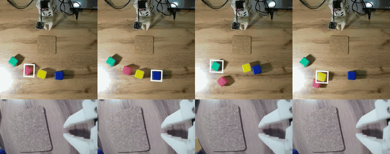
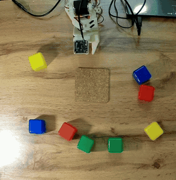
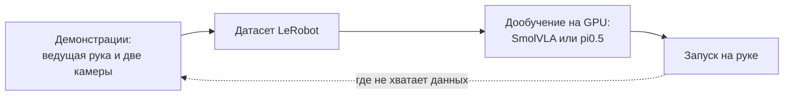
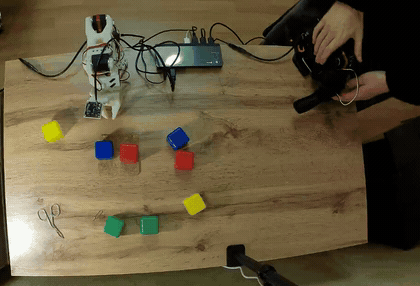
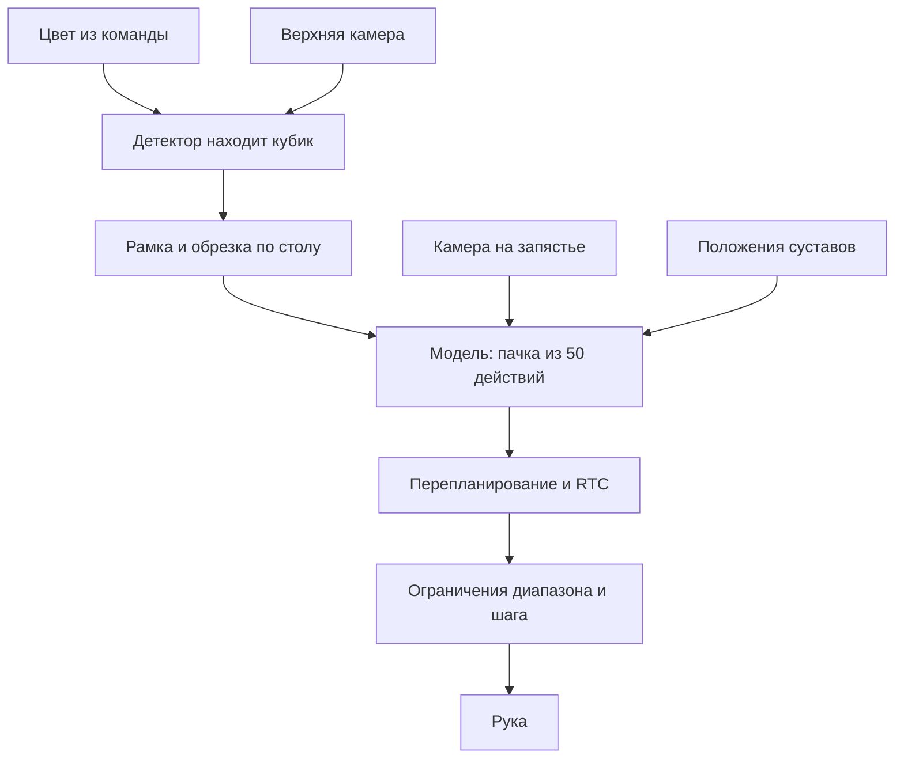
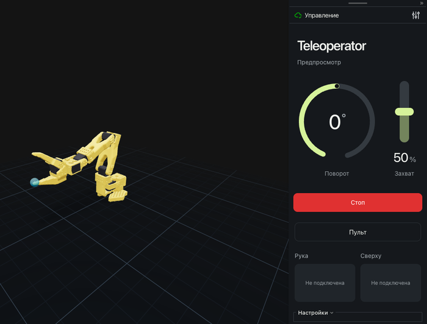
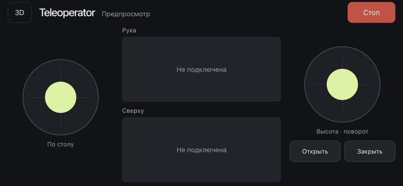
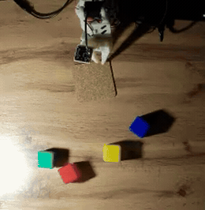
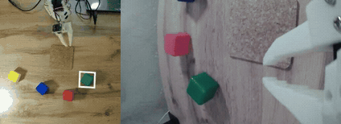
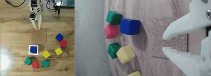

# lerobot_plan_cubes

Настольная рука [SO-101](https://github.com/TheRobotStudio/SO-ARM100) по текстовой команде берёт кубик нужного цвета и ставит его на пробковую площадку. Следующая цель: собрать из трёх кубиков пирамидку. Модели учатся на демонстрациях, которые человек записывает второй, ведущей рукой. Всё, что показано ниже, снято на настоящей руке, симуляции здесь нет.

<p align="center">
  
</p>
<p align="center"><sub>Модель pi0.5, команда «зелёный», человек не вмешивался. Слева верхняя камера, справа камера на запястье. Белая рамка отмечает кубик из команды. Ускорено в 2 раза. <a href="runs/policy-run-20261105-211635-green.mp4">Полное видео</a></sub></p>

<!-- VIDEO SLOT: overview -->
<p align="center"></p>
<p align="center"><sub>Скоро здесь будет видео: установка со стороны.</sub></p>
<!-- /VIDEO SLOT -->

## Что уже получается

### Кубик по цвету из команды

<p align="center">
  
</p>
<p align="center"><sub>Одна и та же модель SmolVLA, меняется только цвет в команде. Слева направо: красный, синий, зелёный, жёлтый. Сверху верхняя камера, снизу камера на запястье. Последние четыре попытки серии 3 ноября, ускорено в 2 раза.</sub></p>

Вся серия: 12 попыток в трёх раскладках, по одной на цвет в каждой. На площадке оказалось 8 кубиков из 12, по 2 из 3 на каждый цвет. Чужой кубик рука не взяла ни разу, а каждый взятый донесла. Итоги попыток: [results.csv](runs/series-20261103-191936/results.csv).

Модель pi0.5 на руке 5 ноября без вмешательства человека ставила на площадку синий кубик (на самый край) и дважды зелёный. Серии с подсчётом для неё ещё не было.

### Пирамидка по записи

<p align="center">
  
</p>
<p align="center"><sub>Это ещё не модель, а воспроизведение трёх записанных демонстраций: <code>recording/replay.py</code>, эпизоды 158, 156 и 157, половинная скорость, по сохранённым командам и без обратной связи от камер. Кубики расставлены вручную как в записи. Ускорено в 14 раз.</sub></p>

<!-- VIDEO SLOT: pyramid -->
<p align="center"></p>
<p align="center"><sub>Скоро здесь будет видео: пирамидка целиком.</sub></p>
<!-- /VIDEO SLOT -->

## Как это устроено



### 1. Запись демонстраций

<p align="center">
  
</p>
<p align="center"><sub>Эпизод 157: человек ведёт чёрную ведущую руку, белая ведомая повторяет и ставит жёлтый кубик на вершину. Ускорено в 3 раза.</sub></p>

Двадцать раз в секунду пишутся две камеры (верхняя 1280×720, на запястье 1920×1080) и положения суставов, а к эпизоду добавляется текст задания, например «Pick up the red cube and place it on the platform.». Сейчас записано 159 эпизодов, 62 167 кадров: 108 эпизодов с одним кубиком на площадку и 51 для пирамидки, где на столе 8 кубиков, а одна пирамидка занимает три эпизода подряд.

`recording/record.py` запускает штатный цикл записи LeRobot, но кодирует видео прямо во время эпизода. Поэтому следующий эпизод начинается через 0,6 с, а не через 20–35 с. Он же на macOS держит ровный шаг цикла: 19,95 кадра в секунду вместо 18,7.

### 2. Обучение

Дообучаются две готовые модели, [SmolVLA](https://huggingface.co/lerobot/smolvla_base) и [pi0.5](https://huggingface.co/lerobot/pi05_base), штатным обучением из форка [lerobot_cubes](https://github.com/Kotstantinovskiy/lerobot_cubes) (LeRobot 0.4.4).

| | SmolVLA | pi0.5 |
| --- | --- | --- |
| Веса чекпойнта | 1,2 ГБ | 14 ГБ |
| 20 000 шагов на одной GPU | около 2–2,5 часа, H200 или H100 | около 14 часов, H100 |
| Пачка действий на руке | 0,63–0,72 с на самом Mac | 180–190 мс через сервер с GPU |

Что сделано сверх штатного рецепта:

- **Рамка на цели.** Детектор находит кубик названного цвета и рисует вокруг него белую рамку на верхней камере. Цвет понимает детектор, а модели остаётся взять то, что в рамке.
- **Обрезка верхней камеры.** От кадра остаётся только выровненный стол. Иначе модель видит ведущую руку и оператора, которые трогаются раньше ведомой, и может выучить, что надо ждать их.
- **Аугментация.** Сдвига оттенка нет, потому что он уводит красный к оранжевому, а задача задаётся цветом. Зато диапазон яркости шире и есть неравномерный свет: все записи сделаны вечером с лампой слева, а рука работает и днём.
- **Скорость.** Кадры уменьшаются ещё в процессах загрузки, а сами процессы не перезапускаются между эпохами. Обучение SmolVLA занимает около 2 часов вместо почти 4.

Подробности и замеры: [training/README.md](training/README.md).

### 3. Запуск на руке



**Перепланирование (`--replan 10`).** Модель выдаёт сразу пачку из 50 действий, это 2,5 с движения. Без флага рука исполняет её вслепую и замирает примерно на секунду, пока считается следующая. С флагом следующая пачка считается в фоне по свежему кадру, и рука идёт без остановок: около 18 шагов в секунду вместо 15.

**RTC (`--rtc`).** Каждая новая пачка начинается не там, где кончилась прежняя, и на стыке рука дёргается. Real-Time Chunking подтягивает начало новой пачки к остатку старой. Наибольший скачок команды на стыке, в единицах суставов:

| | медиана | 90-й процентиль | максимум |
| --- | --- | --- | --- |
| без RTC | 18,4 | 32,0 | 68,0 |
| с RTC | 1,9 | 3,7 | 7,4 |

<p align="center">
  
</p>
<p align="center"><sub>Камера на запястье, реальная скорость, похожая раскладка: слева без RTC, справа с RTC.</sub></p>

**Защита.** Каждая команда обрезается до диапазона суставов из демонстраций и до `--max-step` единиц за кадр. Если момент моторов уже включён или калибровка не совпала, запуск отказывается и руку не трогает. В конце, после Ctrl+C или ошибки рука складывается в исходную позу, а второй Ctrl+C сразу отключает момент.

**pi0.5 на сервере.** Для Mac эта модель велика, поэтому пачки считает `inference/policy_server.py` на машине с GPU. Ноутбук через SSH-туннель отправляет кадры и управляет рукой, датасет и чекпойнт на нём не нужны. Если связь пропала, рука складывается в исходную позу.

### 4. Планировщик пирамидки

`inference/run_pyramid.py` по кадру верхней камеры выбирает следующий шаг: какой кубик на какое место. Рукой он пока не двигает. Есть два варианта: обычный цикл без сети (`--planner loop`) и языковая модель через OpenRouter (`--planner llm`), которой цель пишется свободным текстом, например «Сверху цвет банана, внизу холодные цвета», а каждый её шаг проверяют правила. Цикл проверен на настоящих кадрах пирамидки, настоящего запроса к OpenRouter ещё не было.

### 5. Управление без ведущей руки

Рукой можно управлять из браузера на Mac и с iPhone, в том числе двумя стиками в горизонтальной раскладке. Это отдельное приложение, оно живёт в своём репозитории: [teleoperator](https://github.com/Kotstantinovskiy/teleoperator).

| Панель на Mac | Пульт в горизонтальной раскладке |
| --- | --- |
|  |  |

<sub>Снято в браузере на Mac, без робота и с выключенными камерами.</sub>

<!-- VIDEO SLOT: iphone -->
<p align="center"></p>
<p align="center"><sub>Скоро здесь будет видео: управление настоящей рукой с iPhone.</sub></p>
<!-- /VIDEO SLOT -->

## Как менялись результаты

| 17 октября | 26 октября | 27 октября |
| --- | --- | --- |
|  |  |  |
| Базовая модель без дообучения: к кубикам не подходит | 20 эпизодов, команда «синий»: идёт к другим кубикам | 40 эпизодов и рамка: подъезжает к нужному кубику, но не берёт |

<sub>Верхняя камера, ускорено в 2,5 раза.</sub>

| Дата | Модель и данные | Что было на руке |
| --- | --- | --- |
| 17 октября | `smolvla_base` без дообучения | к кубикам не подходит |
| 26 октября | SmolVLA, 20 эпизодов | кубик по цвету не выбирает, захватов не было (синий) или промах на несколько сантиметров (красный) |
| 27 октября | SmolVLA, 40 эпизодов, рамка | подъезжает к нужному кубику, но не берёт; в 3 прогонах из 8 стоит на месте |
| 3 ноября | SmolVLA, 88 эпизодов, рамка, обрезка, RTC | 8 из 12 на площадке, чужой кубик не взят ни разу |
| 4 ноября | pi0.5, 88 эпизодов, рамка, обрезка, RTC | красный и синий на площадке, но рядом с кубиком была рука человека; повёрнутый зелёный не взят |
| 5 ноября | SmolVLA, 154 эпизода и дообучение на пирамидках | один чистый захват, кубик встал мимо площадки на ширину кубика |
| 5 ноября | pi0.5, 154 эпизода, рамка, выровненная обрезка, RTC | без вмешательства: синий на край площадки, зелёный дважды на площадку; серии ещё не было |

Оценка на записанных кадрах (`training/eval_offline.py`) хорошо показывает, читает ли модель цвет в команде, но успех на руке она не предсказывала. Модель на 20 эпизодах офлайн явно реагировала на цвет, а на руке кубик по цвету не выбирала: при таком числе записей она запомнила траектории.

## Что пока не получается

| Кубик повёрнут к губкам | Взят чужой кубик |
| --- | --- |
|  |  |
| pi0.5, 4 ноября: рука дошла до нужного кубика и зависла над ним. Ускорено в 2 раза. [Видео](runs/policy-run-20261104-185409-green.mp4) | pi0.5, 5 ноября: рамка на синем, а рука прошла над ним и взяла зелёный. Ускорено в 2 раза. [Видео](runs/policy-run-20261105-175859-blue.mp4) |

- **Сама модель пирамидку пока не собирает.** На вершину кубик она не ставила: единственный завершённый прогон pi0.5 отпустил красный рядом с основанием, причём кубик перед этим поправила рука человека. Дообучение pi0.5 на пирамидках на руке ещё не запускалось.
- **Поворот кубика.** При повороте около 40–45° рука зависает над кубиком, при 25° брала. Это наблюдение по нескольким прогонам, отдельно оно не проверялось.
- **Рамка не едет за кубиком.** Рамка рисуется один раз, до движения. Если рука сдвинула кубик, модель ищет его на старом месте.
- **Дальние кубики.** В серии 3 ноября рука не дотягивалась до кубиков, стоявших дальше всех демонстраций. После этого записаны эпизоды и с такими раскладками, но заново серию не повторяли.
- **Новый код на железе.** Рефакторинг 6 ноября проверен тестами и сравнением со старым кодом на подставных устройствах. Все прогоны на этой странице сделаны до него, на настоящей руке, камерах и GPU новый код ещё не запускался.

## Оборудование

| Что | Модель |
| --- | --- |
| Две руки, ведомая и ведущая | SO-101 |
| Верхняя камера | Sport Cam, 1280×720 |
| Камера на запястье | Innomaker U20CAM, 1920×1080 |
| Компьютер у руки | Mac, замеры на M3 с 16 ГБ памяти |
| Обучение и сервер pi0.5 | Linux, NVIDIA H100 или H200 |

## Установка

Рядом с этим репозиторием нужен форк LeRobot с патчем выбора камер на macOS:

```bash
git lfs install
git clone --recurse-submodules git@github.com:Kotstantinovskiy/lerobot_cubes.git
git clone git@github.com:Kotstantinovskiy/lerobot_plan_cubes.git

cd lerobot_cubes
python3.12 -m venv .venv
.venv/bin/python -m pip install --upgrade pip
.venv/bin/python -m pip install -e '.[smolvla,feetech]' pandas pyarrow
# Только на macOS, для камер:
.venv/bin/python -m pip install 'opencv-python-headless==4.12.0.88' pyobjc-framework-AVFoundation

cd ../lerobot_plan_cubes
source ../lerobot_cubes/.venv/bin/activate
```

Порты рук, камеры и калибровки заданы в `config.json`. Для другой машины удобно скопировать его в `config.local.json` (он не попадает в Git) и передавать через `--config`. Подробнее: [docs/TRANSFER.md](docs/TRANSFER.md). На машине с GPU окружение готовит `bash training/setup_linux.sh`.

Видео прогонов лежат в Git LFS: `git lfs pull --include='runs/**'`.

## Основные команды

Все команды запускаются из корня репозитория с активированным окружением.

```bash
# Телеуправление без записи: ведомая рука повторяет ведущую
python recording/teleoperate.py

# Запись демонстраций: цвета по очереди, дозапись в датасет
python recording/record.py --color red,blue,green,yellow --episodes 8 --resume

# Воспроизвести эпизод и сложить руку в исходную позу
python recording/replay.py --episode 157 --speed 0.5
python recording/rest.py

# Обучение на машине с GPU
bash training/fetch_dataset.sh
python training/label_boxes.py
python training/train.py --gpu 0 --target-box --top-crop --run-name my-run

# Проверка чекпойнта на записанных кадрах, без руки
python training/eval_offline.py --policy outputs/train/my-run/checkpoints/last/pretrained_model

# Запуск на руке
HF_HUB_OFFLINE=1 python inference/run_policy.py --policy <папка pretrained_model> --color red --seconds 30 --max-step 10 --replan 10 --rtc

# Серия попыток с итогами в CSV
HF_HUB_OFFLINE=1 python inference/run_series.py --policy <папка pretrained_model> --layouts 3 --seconds 30 --max-step 10 --replan 10 --rtc

# Тесты без оборудования
python -m unittest discover -s tests
```

## Структура репозитория

```
config.json    настройки рук, камер и датасета
calibration/   калибровки ведущей и ведомой руки
recording/     запись демонстраций, телеуправление, воспроизведение, возврат в исходную позу, обрезка простоя
training/      обучение SmolVLA и pi0.5 на машине с GPU, проверка чекпойнтов без робота
inference/     запуск модели на руке, сервер pi0.5, детектор кубиков, планировщик пирамидки
diagnostics/   диагностика и замеры камер
tests/         тесты без оборудования
runs/          видео прогонов на руке и итоги серий (видео в Git LFS)
docs/          журнал проекта, перенос на другой компьютер, камеры, гифки этой страницы
data/          датасеты LeRobot; в Git только первый маленький color_cubes_vga (видео в Git LFS)
camera_check/  локальные проверочные записи (не в Git)
outputs/       результаты обучения (не в Git)
```

## Документы

- [training/README.md](training/README.md): настройки обучения, замеры скорости, рамка, обрезка, pi0.5, запуск через сервер.
- [docs/HISTORY.md](docs/HISTORY.md): журнал проекта с замерами по датам и ссылками на архивы датасета и чекпойнтов.
- [docs/TRANSFER.md](docs/TRANSFER.md): перенос этих рук на другой компьютер.
- [docs/LOCAL_CAMERAS.md](docs/LOCAL_CAMERAS.md): камеры и как они выбираются.
- [calibration/README.md](calibration/README.md): калибровки рук.
- [teleoperator](https://github.com/Kotstantinovskiy/teleoperator): управление рукой из браузера и с iPhone.
